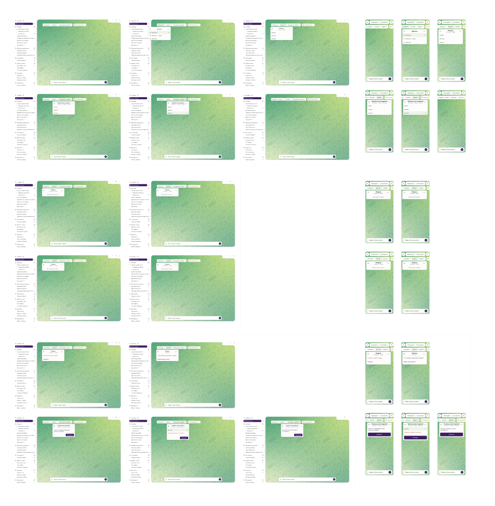

# Aurora · Смена движка в чате

23 ноября 2026. Выбор уровня применяет настройки сразу. Если уровни отсутствуют или не загрузились, в меню остаётся кнопка «Применить». В шапке выпадающего меню заголовок и подзаголовок расположены по центру, как в Android App Bar на референсе оператора. [Прототип Desktop](https://www.figma.com/proto/ivLmgulIBIkMzOw8sgvKxj/Aurora-DS?page-id=426-59925&node-id=426-59926&starting-point-node-id=426-59926) · [Прототип Android](https://www.figma.com/proto/ivLmgulIBIkMzOw8sgvKxj/Aurora-DS?page-id=426-59925&node-id=426-59927&starting-point-node-id=426-59927)

## Что меняется для пользователя

На присланном фрагменте и в Figma три стрелки рядом с движком, моделью и рассуждением выглядят как независимые настройки. Строка движка имеет знакомую ACP-иконку, имя и галочку. Выбор различим и по форме, и по цвету. При сверке по `unslop/references/signs.md` основной проблемой оказалась связь между действиями. После выбора другого движка пользователю нужно увидеть, чьи модели загружаются, и завершить выбор допустимой комбинации. [Исходное меню со скриншота в Figma](https://www.figma.com/design/ivLmgulIBIkMzOw8sgvKxj/Aurora-DS?node-id=382-210496) · [Основной Desktop Aurora](https://www.figma.com/design/ivLmgulIBIkMzOw8sgvKxj/Aurora-DS?node-id=2-175087)

## Направление

1. **Продукт.** Пользователь Heartbeat меняет движок чата и выбирает подходящие ему модель и уровень рассуждения.
2. **Характер.** Компактный, спокойный, предсказуемый.
3. **Мир.** Светлое меню Aurora поверх рисунка чата, знакомые строки и платформенный шрифт.
4. **Моменты.** При смене шага меню указывает на соответствующий параметр в шапке чата. Во время ожидания индикатор появляется в области списка моделей.
5. **Сигнатура.** Имя выбранного движка сопровождает пользователя до конца, а знакомая зелёная галочка отмечает выбранную строку.

## Три шага в одном меню

| Шаг | Что видно | Действие |
| --- | --- | --- |
| 1 из 3 · Движок | Текущий движок с галочкой, остальные настроенные движки. В примере «Помощник», «Помощник — ревью», «Навигатор» | Нажать «Помощник — ревью». Меню переходит под кнопку модели |
| 2 из 3 · Модель | Стрелка назад, заголовок «Модель», под ним «Помощник — ревью». В списке только модели выбранного движка | Выбрать модель и перейти к выбору рассуждения |
| 3 из 3 · Уровень рассуждения | В подзаголовке видны движок и модель. Галочка отмечает текущий уровень | Выбрать «Высокое». Выбор сохраняет все три значения и при успехе закрывает меню |

До применения настроек все три значения остаются черновиком. «Назад» возвращает на предыдущий шаг и восстанавливает его выбор. Смена движка сбрасывает черновую модель и уровень, смена модели сбрасывает уровень. Закрытие снаружи или по Escape отменяет черновик. В строке чата до применения видна действующая комбинация. Кнопка модели открывает второй шаг для действующего движка. Кнопка рассуждения открывает третий шаг для действующей пары.

## Ожидание и восстановление

- **Загрузка моделей.** На втором шаге сразу появляются имя движка и текст «Загружаем модели…». Рядом с подписью сразу видно кольцо. Через 400 мс ожидания оно начинает вращаться. Кольцо и подпись выровнены по центру области списка на Desktop и Android. Пока идёт запрос, «Назад» и закрытие доступны. При уменьшенном движении индикатор статичен. Список из действительного кэша можно показать сразу.
- **Пустой ответ.** «У этого движка нет доступных моделей» и действие «Выбрать другой движок» возвращают на первый шаг.
- **Ошибка получения.** «Не удалось загрузить модели» и «Повторить». Повтор относится к тому же движку. Ответ на более ранний запрос после возврата или смены движка игнорируется.
- **У модели нет настройки рассуждения.** Если движок явно сообщает об отсутствии поддержки, на третьем шаге видны «Модель не поддерживает выбор уровня рассуждения» и «Применить». Сохраняется пара движок–модель с отсутствующим уровнем. При пустом списке или ошибке загрузки уровней «Применить» сохраняет пару без явного уровня.
- **Ошибка применения.** Меню остаётся на третьем шаге с выбранными значениями, сообщением «Не удалось применить настройки» и действием «Повторить». В шапке чата остаётся последняя рабочая комбинация.

## Платформы и проверка

У каждого шага одна верхняя панель высотой 56. На первом шаге по центру стоит заголовок «Движок». На втором под заголовком виден выбранный движок, на третьем — движок и модель. Меню занимает 296 dp на Desktop и до 326 dp на Android. Заливка строки доходит до внешнего контура панели. Стрелка слева возвращает на шаг назад, а с первого шага — в чат. Справа виден счётчик шагов. Кнопки по краям имеют одинаково зарезервированное место, поэтому центр текста совпадает с центром меню.

На Windows и macOS меню открывается вниз. Центр заголовка «Модель» находится на одной вертикали с центром «Базовая» в шапке чата. Это положение сохраняется при ожидании, загрузке, пустом ответе и ошибке. На третьем шаге якорем становится текущее значение рассуждения. У границы окна меню сдвигается внутрь доступной области. Стрелки клавиатуры перемещают фокус по строкам, Enter выбирает строку, Escape закрывает меню и возвращает фокус на исходную кнопку.

На Android меню ограничено шириной окна. Если до края мало места, заголовок и подзаголовок остаются по центру панели, а активный параметр виден по подсветке в шапке чата. Группа параметров прокручивается до текущей кнопки. Строки списка, возврат и действие применения имеют сенсорную цель от 48 dp. Системный жест «Назад» возвращает на предыдущий шаг, на первом шаге закрывает меню.

## Кадры и проверка

| Состояние | Desktop | Android |
| --- | --- | --- |
| Выбор движка | [Движок](https://www.figma.com/design/ivLmgulIBIkMzOw8sgvKxj/Aurora-DS?node-id=426-60903) | [Движок](https://www.figma.com/design/ivLmgulIBIkMzOw8sgvKxj/Aurora-DS?node-id=426-61083) |
| Загрузка после выбора | [Лоадер](https://www.figma.com/design/ivLmgulIBIkMzOw8sgvKxj/Aurora-DS?node-id=426-60921) | [Лоадер](https://www.figma.com/design/ivLmgulIBIkMzOw8sgvKxj/Aurora-DS?node-id=426-61100) |
| Модели загружены | [Модель](https://www.figma.com/design/ivLmgulIBIkMzOw8sgvKxj/Aurora-DS?node-id=426-60939) | [Модель](https://www.figma.com/design/ivLmgulIBIkMzOw8sgvKxj/Aurora-DS?node-id=426-61117) |
| Подтверждение и результат | [Выбор уровня](https://www.figma.com/design/ivLmgulIBIkMzOw8sgvKxj/Aurora-DS?node-id=426-60975) · [Результат](https://www.figma.com/design/ivLmgulIBIkMzOw8sgvKxj/Aurora-DS?node-id=556-158378) | [Выбор уровня](https://www.figma.com/design/ivLmgulIBIkMzOw8sgvKxj/Aurora-DS?node-id=426-61151) · [Результат](https://www.figma.com/design/ivLmgulIBIkMzOw8sgvKxj/Aurora-DS?node-id=556-158432) |
| Нет моделей, ошибка загрузки | [Пустой список](https://www.figma.com/design/ivLmgulIBIkMzOw8sgvKxj/Aurora-DS?node-id=426-61029) · [Повторить](https://www.figma.com/design/ivLmgulIBIkMzOw8sgvKxj/Aurora-DS?node-id=426-61011) | [Пустой список](https://www.figma.com/design/ivLmgulIBIkMzOw8sgvKxj/Aurora-DS?node-id=426-61202) · [Повторить](https://www.figma.com/design/ivLmgulIBIkMzOw8sgvKxj/Aurora-DS?node-id=426-61185) |
| Нет настройки рассуждения, ошибка применения | [Без уровня](https://www.figma.com/design/ivLmgulIBIkMzOw8sgvKxj/Aurora-DS?node-id=426-61047) · [Повторить](https://www.figma.com/design/ivLmgulIBIkMzOw8sgvKxj/Aurora-DS?node-id=426-61065) | [Без уровня](https://www.figma.com/design/ivLmgulIBIkMzOw8sgvKxj/Aurora-DS?node-id=426-61219) · [Повторить](https://www.figma.com/design/ivLmgulIBIkMzOw8sgvKxj/Aurora-DS?node-id=426-61236) |

Для просмотра основного пути нажать «Помощник», выбрать «Помощник — ревью», дождаться моделей, выбрать «Для кода», затем «Высокое». Ветка «Навигатор» показывает пустой список, а модель «Быстрая» — применение без настройки рассуждения. Ошибки доступны отдельными стартами в прототипе. Списки демонстрационные, ожидание ответа воспроизводят таймеры Figma. Нативный фокус, TalkBack и системный жест возврата проверяются в Compose.

## Раскладка листа в Figma

В общей секции слева собраны кадры Desktop, справа — соответствующие кадры Android. В верхнем ряду показан путь от чата до применения настроек, в среднем — ожидание и загрузка моделей, в нижнем — ошибки и ограничения. Внутри каждой секции кадры читаются слева направо, затем сверху вниз. [Открыть лист в Figma](https://www.figma.com/design/ivLmgulIBIkMzOw8sgvKxj/Aurora-DS?node-id=555-157283)

