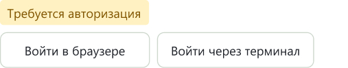
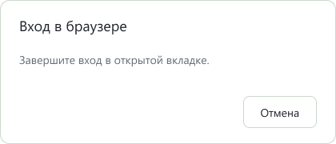
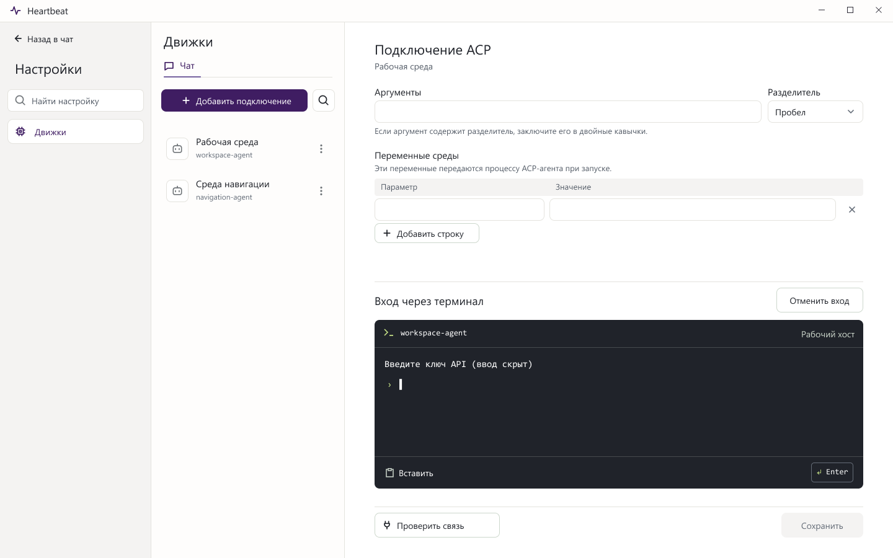
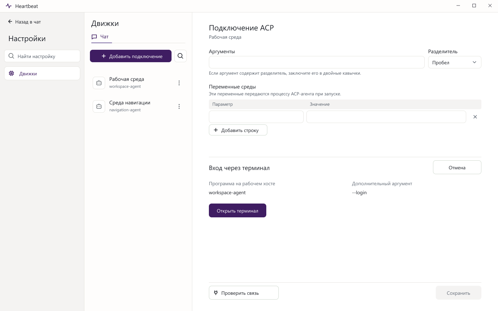
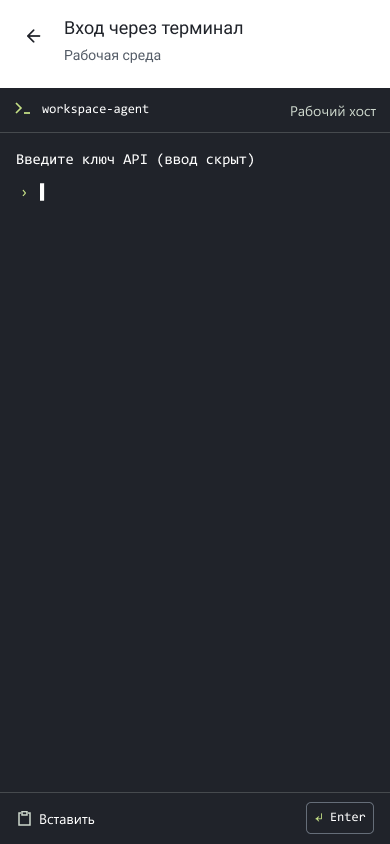

# Heartbeat · Вход в ACP-подключение

Пользователь проверяет связь с агентом и при необходимости входит в аккаунт из настроек подключения. На Windows и macOS терминал раскрывается в правой панели, под переменными среды. На Android он занимает отдельный экран. Оба представления используют компонент **Aurora / Терминал**. Вход относится к общему подключению, которым пользуются движок и его копии. [Настройки движков](engine-settings.md) · [Компонент в Figma](https://www.figma.com/design/ivLmgulIBIkMzOw8sgvKxj/Aurora-DS?node-id=444-75345)

## Когда появляется выбор

«Проверить связь» запускает агент на рабочем хосте и выполняет `initialize`. Из ответа Heartbeat получает согласованную версию ACP и список `authMethods`. Список описывает доступные способы входа. Отдельным сигналом служит запрос агента на авторизацию, например ошибка `auth_required` при создании сессии. [Аутентификация ACP v1](https://agentclientprotocol.com/protocol/v1/authentication)

| Состояние | Что показывает форма |
| --- | --- |
| Проверка ещё не выполнена или идёт | Действие «Проверить связь» либо статус проверки. Варианты входа скрыты. |
| Проверка завершилась ошибкой | Причина сбоя, «Повторить» и «Логи». Введённые параметры сохраняются. |
| Агент ответил и разрешает работу | «Проверка связи завершена · ACP v1» с фактически согласованной версией. Если агент объявил способы входа, они доступны под результатом проверки. |
| Агент запросил вход | Единственный статус **«Требуется авторизация»** на светло-жёлтом фоне. Под ним сразу видны кнопки доступных способов. Одна кнопка соответствует одному способу. |
| Агент запросил вход, но ни один способ недоступен на этом хосте | Та же жёлтая надпись и доступное пояснение агента. Пользователь может исправить параметры подключения и повторить проверку. |

Изменение команды, аргументов или окружения сбрасывает результат проверки и скрывает прежние способы входа. Запоздавший ответ предыдущей попытки не восстанавливает их. Валидные изменения формы можно сохранить до проверки и до входа. Полные кадры выбора способа — [Windows](../previews/aurora-acp-auth/382-218915.png), [macOS](../previews/aurora-acp-auth/382-219777.png) и [Android](../previews/aurora-acp-auth/382-220777.png). [Кадр без запроса на вход](https://www.figma.com/design/ivLmgulIBIkMzOw8sgvKxj/Aurora-DS?node-id=442-74838)

## Вход в браузере

В примере агент объявляет браузерный вход типа `agent`. «Войти в браузере» вызывает `authenticate` с идентификатором выбранного метода. Агент открывает страницу провайдера, а Heartbeat подсказывает продолжить в открытой вкладке. Успешный ответ агента переводит подключение в состояние «Вход выполнен». Отмена возвращает к выбору. Для другого метода типа `agent` клиент использует название, которое сообщил агент. [Кадр Figma](https://www.figma.com/design/ivLmgulIBIkMzOw8sgvKxj/Aurora-DS?node-id=441-74632)

## Вход через терминал

1. **«Войти через терминал».** Heartbeat показывает программу на рабочем хосте, дополнительные аргументы и объявленные агентом переменные среды для входа. В примере это `workspace-agent` и аргумент `--login`. На Desktop параметры раскрываются в самой форме.
2. **«Открыть терминал».** Heartbeat запускает отдельный интерактивный экземпляр настроенной программы на том же хосте. К исходным аргументам добавляются аргументы метода, его окружение переопределяет одноимённые переменные запуска. Терминальный метод доступен, только если клиент может воспроизвести такой запуск. Для этого метода вызов `authenticate` не используется. [Правила запуска ACP](https://agentclientprotocol.com/protocol/v1/authentication#terminal-authentication)
3. **Ввод.** Фокус переходит в терминал. Пользователь отвечает на приглашение процесса. «Вставить» передаёт текст в сеанс, Enter отправляет нажатие клавиши. Режим отображения ввода задаёт программа. В примере ввод ключа скрыт.
4. **Завершение.** При коде выхода 0 Heartbeat повторно подключается к агенту и выполняет `initialize`. После успешного восстановления связи форма показывает «Вход выполнен · ACP v1». Если отказ произошёл на этом последнем шаге, действие «Повторить подключение» заново выполняет подключение.

### Windows и macOS

Параметры запуска, интерактивный терминал и проверка введённого ключа последовательно занимают одну секцию в правой панели. Окно сохраняет обычные системные кнопки, список движков и нижние действия формы. «Отменить вход» находится в заголовке секции. [Windows в Figma](https://www.figma.com/design/ivLmgulIBIkMzOw8sgvKxj/Aurora-DS?node-id=444-76019) · [macOS в Figma](https://www.figma.com/design/ivLmgulIBIkMzOw8sgvKxj/Aurora-DS?node-id=444-77368)

Параметры перед запуском и терминал на macOS

### Android

«Открыть терминал» ведёт на экран «Вход через терминал» с именем подключения в шапке. Панель клавиш располагается над системной клавиатурой. При повороте устройства и изменении доступной высоты обновляется размер существующего сеанса. Стрелка назад отменяет вход и возвращает к исходному подключению. Процесс выполняется на рабочем хосте. [Android в Figma](https://www.figma.com/design/ivLmgulIBIkMzOw8sgvKxj/Aurora-DS?node-id=441-74665)

## Общая оболочка и результат входа

| Часть | Ответственность |
| --- | --- |
| Сеанс терминала на рабочем хосте | Владеет интерактивным процессом и псевдотерминалом (PTY). Передаёт вывод, принимает ввод и размеры области, сообщает ошибку запуска и код завершения. |
| Компонент Aurora / Терминал | Показывает программу, хост, вывод, приглашение и курсор. Даёт прокручивать вывод и передавать ввод. В состоянии ожидания вывод остаётся видимым, приём ввода отключается. Компонент принимает эти данные и для других интерактивных процессов. |
| Сценарий входа ACP | Выбирает способ и параметры запуска, обрабатывает отмену и результат, повторно подключается и возвращает пользователя в нужную запись. |

При отмене Heartbeat останавливает процесс входа и возвращает выбор способов. При ненулевом коде выхода или неудачном запуске форма показывает причину и позволяет повторить вход. Подтверждение входа относится к конкретным подключению и попытке. Скрытый ввод не попадает в настройки или копируемые журналы. [Компонент и поведение при изменении размеров](../design-system.md#терминал-рабочего-хоста)

## Проверка при приёмке

1. Открыть новую форму, проверить связь и воспроизвести ответы с нулём, одним и двумя доступными методами. Жёлтый статус появляется при запросе авторизации. Изменить команду во время проверки и убедиться, что старый ответ не возвращает устаревшие кнопки.
2. Выбрать браузерный способ. Отмена возвращает выбор, а подтверждение от агента завершает вход для выбранного подключения.
3. Пройти «Войти через терминал» → «Открыть терминал». На Windows и macOS весь путь проходит в панели. На Android открывается отдельный экран. Проверить ввод, вставку, Enter и возврат в ту же запись.
4. Проверить отдельно отмену, ненулевой код выхода и разрыв связи после кода 0. В первых двух случаях доступен новый вход, в последнем — повторное подключение. Ни один из этих исходов не показывает успешный вход преждевременно.
5. В Figma нажать Enter при пустом вводе — появится «Сначала введите ключ». Затем нажать «Вставить» и Enter — прототип подставит демонстрационную маску, покажет «Проверяем ключ…» и вернёт к подключению. Для проверки макета настоящий ключ не нужен. [Проверка на Windows](https://www.figma.com/design/ivLmgulIBIkMzOw8sgvKxj/Aurora-DS?node-id=444-76468) · [Проверка на Android](https://www.figma.com/design/ivLmgulIBIkMzOw8sgvKxj/Aurora-DS?node-id=444-75441)
