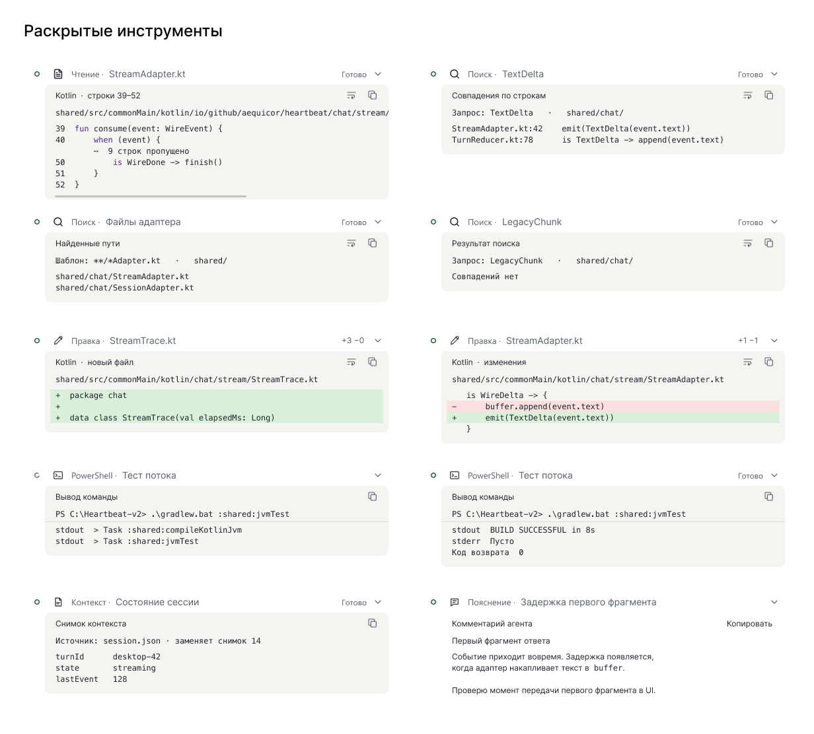
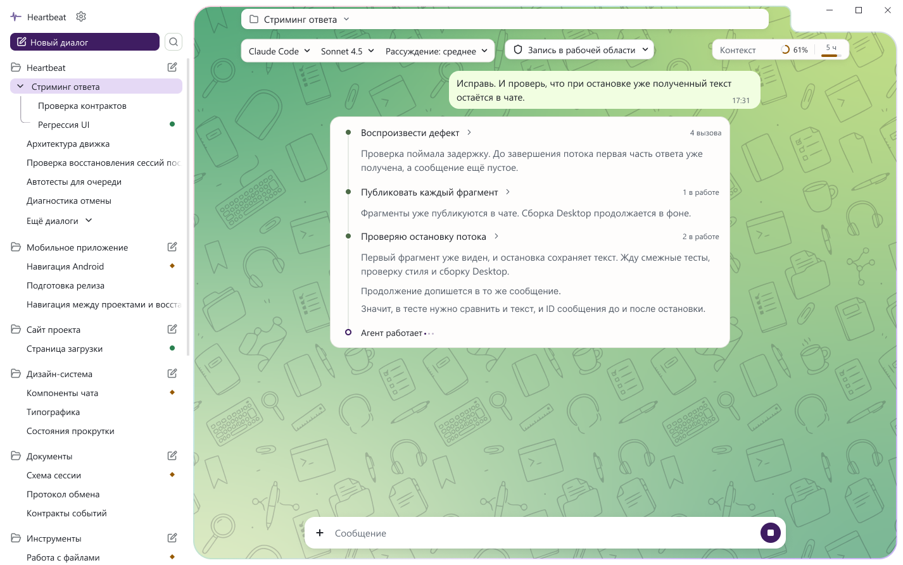
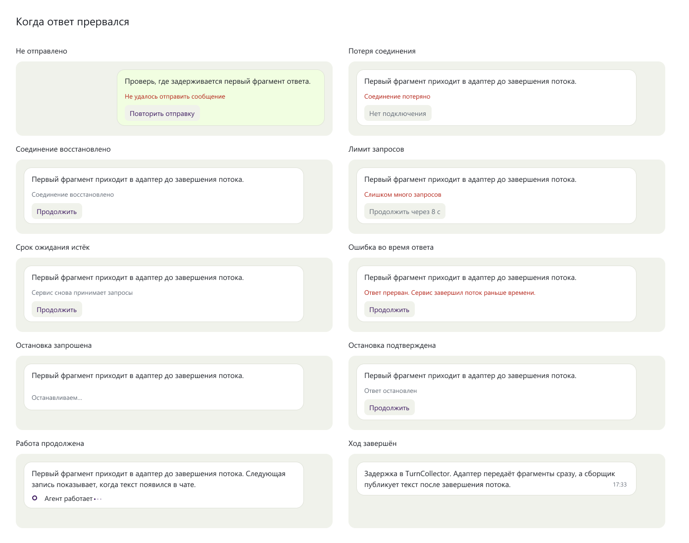

# Desktop Aurora · рабочая область агента

Одна отправка пользователя открывает один ответ агента. В одном облачке пользователь видит, чем агент занят сейчас, какие инструменты уже сработали и к какому выводу он пришёл. Первый фрагмент ответа появляется сразу. Последующие фрагменты дописываются туда же. [Рабочая область в Figma](https://www.figma.com/design/ivLmgulIBIkMzOw8sgvKxj/Aurora-DS?node-id=496-128870)

## От отправки до первого события

Слева остаётся навигация по проектам и диалогам. Над перепиской расположены название диалога, параметры агента, доступ к рабочей области и контекст. Поле ввода закреплено снизу. В многострочном черновике вложения видны над текстом. Пользователь может удалить отдельный файл. После отправки текст и оставшиеся вложения переходят в одну пользовательскую реплику.

После подтверждения доставки в переписке сразу появляются реплика пользователя и область ответа. На оси видны полое фиолетовое кольцо, подпись «Агент работает» и три точки. В поле ввода доступна остановка. Пока агент не прислал событий, у ответа нет истории вызовов и времени завершения. [Ожидание первого события](https://www.figma.com/design/ivLmgulIBIkMzOw8sgvKxj/Aurora-DS?node-id=467-159620) · [Черновики с вложениями](https://www.figma.com/design/ivLmgulIBIkMzOw8sgvKxj/Aurora-DS?node-id=477-177480)

## Файлы пользователя и агента

Для документов и изображений обеих ролей есть [отдельная спецификация с миниатюрами и открытым просмотром](desktop-aurora-attachments.md).

Пользователь прикрепляет файлы к черновику. После отправки они видны в его реплике над подписью. Строка показывает имя и тип файла, для изображения с доступным превью используется миниатюра. При ошибке доставки повтор сохраняет тот же набор вложений.

Файл, переданный агентом, появляется внутри его ответа. У патча видны имя и сводка изменений, у документа — имя и формат. Справа расположены действия просмотра и скачивания. Просмотр патча открывает изменения для чтения. Путь, который инструмент прочитал или нашёл, остаётся в результатах инструмента. Файл становится вложением при получении события с самим артефактом.

При остановке или ограничении запросов уже доставленные файлы остаются у исходного ответа. Продолжение потока и повторная доставка того же события сохраняют по одному экземпляру каждого файла. [Правила вложений](../plans/aurora-attachments.md)

| Секция | Что показано | Иллюстрация |
| --- | --- | --- |
| [Обзор Desktop](https://www.figma.com/design/ivLmgulIBIkMzOw8sgvKxj/Aurora-DS?node-id=502-132409) | Журнал и снимок экрана пользователя, патч и Markdown от агента | [Снимок](../previews/desktop-agent-turns/files-overview.png) |
| [От запроса до итога](https://www.figma.com/design/ivLmgulIBIkMzOw8sgvKxj/Aurora-DS?node-id=502-133311) | Агент ранее приложил заметки. Пользователь передал журнал, начался поиск | [Снимок](../previews/desktop-agent-turns/files-active.png) |
| [История ответа](https://www.figma.com/design/ivLmgulIBIkMzOw8sgvKxj/Aurora-DS?node-id=502-134239) | Снимок экрана в запросе и готовый патч под раскрытой историей | [Снимок](../previews/desktop-agent-turns/files-history.png) |
| [Ошибка доставки и повтор](https://www.figma.com/design/ivLmgulIBIkMzOw8sgvKxj/Aurora-DS?node-id=502-135316) | Журнал остаётся у ошибочной реплики. Ранее полученный файл агента виден выше | [Снимок](../previews/desktop-agent-turns/files-retry.png) |
| [Остановка и продолжение](https://www.figma.com/design/ivLmgulIBIkMzOw8sgvKxj/Aurora-DS?node-id=502-136219) | Полученный Markdown остаётся в остановленном ответе | [Снимок](../previews/desktop-agent-turns/files-stopped.png) |
| [Связь и лимит запросов](https://www.figma.com/design/ivLmgulIBIkMzOw8sgvKxj/Aurora-DS?node-id=502-137151) | Уже полученный патч виден в частичном ответе во время ожидания HTTP 429 | [Снимок](../previews/desktop-agent-turns/files-rate-limit.png) |
| [Раскрытие инструментов](https://www.figma.com/design/ivLmgulIBIkMzOw8sgvKxj/Aurora-DS?node-id=502-138084) | Результат поиска раскрыт в том же диалоге с входящим и исходящим файлами | [Снимок](../previews/desktop-agent-turns/files-tool.png) |

## Текущий этап

В строке с первым вызовом от верхней границы облачка до текстового блока цели — 8 dp. От левого края облачка до кольца — 8 dp. Диаметр кольца — 10 dp. От кольца до текста цели — ещё 8 dp. Центр кольца совпадает с серединой первой строки текста. [Первый вызов в Figma](https://www.figma.com/design/ivLmgulIBIkMzOw8sgvKxj/Aurora-DS?node-id=478-106157)

На месте подписи ожидания появляется публичная цель агента, например «Проверяю остановку потока». Кольцо пульсирует во время обмена с LLM, три точки анимируются сразу после подписи. При уменьшенном движении кольцо и точки статичны. Диктор сообщает о начале ожидания один раз. Текущий этап всегда открыт. Его заголовок не имеет шеврона, а строка «Ход работы» появляется после окончания ответа.

Если агент не передал название, клиент один раз выбирает локальную подпись по типу событий. Для чтения подходит «Просмотр файлов», для команд — «Работа в терминале», для смешанного набора — «Работа по запросу». Если есть выбор, предыдущая подпись исключается. Выбор хранится по ID этапа. Поздняя цель агента заменяет подпись на месте. [Активные состояния](https://www.figma.com/design/ivLmgulIBIkMzOw8sgvKxj/Aurora-DS?node-id=467-163726) · [Наборы названий](https://www.figma.com/design/ivLmgulIBIkMzOw8sgvKxj/Aurora-DS?node-id=477-179898)

## Хронология и инструменты

Левый край текста заголовка этапа совпадает с внешним контуром иконки инструмента с учётом толщины штриха. Внутренние поля исходной пиктограммы учитываются отдельно для лупы, файла и остальных инструментов. [Фрагмент макета](../previews/desktop-agent-turns/stage-icon-alignment.png)

В раскрытом этапе заголовок, промежуточный итог, колонка иконок инструментов и фон подробностей начинаются на одной вертикали. Колонка иконок имеет ширину 14 dp. Все названия операций начинаются через 8 dp от её правой границы и стоят на одной высоте внутри строки. Подпись занимает ширину текста вместе с разделителем «·», а через следующие 8 dp начинается путь или описание вызова. Длинный путь сокращается внутри своей колонки. Счётчик этапа и шевроны вызовов выровнены по правому краю. У раскрытого вывода внутренний отступ слева — 8 dp. [Снимок двух ходов](../previews/desktop-agent-turns/longread.png)

В хронологии маркеры занимают колонку шириной 10 dp с отступом 8 dp от левого края облачка. Линия проходит в 13 dp от края, через центры закрашенной точки диаметром 8 dp и фиолетового кольца диаметром 10 dp. При продолжении работы линия соединяет последнюю завершённую операцию и новый активный ход. [Снимок продолжения](../previews/desktop-agent-turns/resumed-timeline.png). [Снимок с тремя завершёнными этапами](../previews/desktop-agent-turns/stage-marker-inset.png)

В прерванном ответе с одним вызовом левый край маркера и начало текста ошибки стоят на одной вертикали, в 8 dp от края облачка. [Снимок прерванного ответа](../previews/desktop-agent-turns/interrupted-reply-alignment.png)

У ответа одна вертикальная линия толщиной 1 dp. Она соединяет центры первого и последнего видимых маркеров. Строки этапов и инструментов стоят на общей оси. У пользовательской реплики с временем в строке вертикальные поля составляют 8 dp. У финального ответа со свёрнутой историей верхнее поле карточки также 8 dp. [Геометрия и компоненты](../design-system.md#ход-работы-инструменты-и-thinking)

| Событие | Изменение в карточке |
| --- | --- |
| Первый вызов | На линии появляется сам инструмент. Его строка открывает подробности. |
| Второй вызов того же этапа | Вызовы объединяются в группу. Первый сохраняет ID, положение, фокус и уже открытый результат. Параллельные вызовы перечисляются в порядке запуска. |
| Завершился один инструмент | Обновляется его строка. При успехе видны зелёное кольцо и «Готово», при ошибке — красное кольцо и «Ошибка». У успешной правки с известным diff допустимы счётчики добавленных и удалённых строк. Этап остаётся активным до публичного итога. |
| Инструмент ещё работает | У вызова серый индикатор с доступным именем «Выполняется». Частичный вывод дописывается в раскрытый результат. |
| В завершённом этапе был ровно один вызов | Строка инструмента сама представляет этап. На оси одна закрашенная точка. Шеврон у строки открывает результат. Единственная публичная запись «Размышления» оформляется так же, её название видно один раз. |

## Как раскрывается инструмент

На общем холсте галерея находится справа внизу, под «Связь и лимит запросов». [Открыть секцию «Раскрытие инструментов» в Figma](https://www.figma.com/design/ivLmgulIBIkMzOw8sgvKxj/Aurora-DS?node-id=502-132403).

Щелчок по строке вызова или нажатие Enter либо пробела на ней открывает результат непосредственно под этой строкой. Шеврон поворачивается вниз. В шапке остаются иконка, тип операции, объект и статус. Для одиночного вызова это та же строка с закрашенной точкой этапа. В группе можно раскрыть несколько вызовов одновременно. Повторное нажатие на шапку закрывает только выбранный результат. Выделение текста, копирование и переключение переноса внутри результата сохраняют его открытым.

| Инструмент | Что видно при раскрытии |
| --- | --- |
| **Читать файл** | В шапке указан файл. В блоке под ней видны язык, полный путь, диапазон чтения и код с исходными номерами строк. Например, при сокращении середины фрагмента переход от строки 40 к строке 50 сопровождается пометкой «9 строк пропущено». |
| **Искать по тексту** | Сначала запрос и каталог поиска, затем по строке на совпадение: путь, номер строки и найденный фрагмент. Для запроса без результатов остаются сам запрос, область поиска и сообщение «Совпадений нет». |
| **Искать файлы** | Шаблон имени и корневой каталог стоят над списком найденных путей. Например, для `**/*Adapter.kt` внутри `shared/` видны пути к каждому подходящему файлу в порядке выдачи. |
| **Написать файл** | Под именем файла видны язык, пометка «новый файл», полный путь и добавленный текст. У каждой добавленной строки есть знак `+` и зелёная подложка. Сводка `+N −0` в шапке берётся из патча. Размер файла отображается, если его передал источник. |
| **Редактировать файл** | Под полным путём расположен diff с неизменёнными строками для контекста. Удалённая строка помечена `−` на красном фоне, новая — `+` на зелёном. При замене одной строки видны обе, а в шапке — `+1 −1`. Для свёрнутого участка указан размер пропуска. |
| **Выполнить PowerShell** | Вверху блока — рабочий каталог и полная команда. Ниже по мере выполнения дописываются stdout и stderr. Код возврата появляется после завершения. При ошибке команда и уже полученный вывод остаются доступны для чтения и копирования. |
| **Внедрить контекст** | Сначала источник снимка, например `time-context` или `session.json`. Если новый снимок заменяет предыдущий, это указано рядом. Ниже сохраняются переданные значения, порядок строк и переносы. |
| **Показать публичные размышления или пояснение** | Внутри — предоставленный агентом текст с абзацами и встроенным кодом. Пока поступают фрагменты, раскрытый текст растёт на месте. Закрытая запись сохраняет выбранное состояние. Пояснение не увеличивает счётчик вызовов инструментов. |

В блоках кода и патча доступны «Копировать» и переключатель переноса. При выключенном переносе длинный путь или строка прокручиваются горизонтально внутри блока, ширина диалога сохраняется. У текстового пояснения обычные абзацы переносятся по ширине. [Рассмотреть примеры в Figma](https://www.figma.com/design/ivLmgulIBIkMzOw8sgvKxj/Aurora-DS?node-id=478-102742)

## Промежуточный итог

Публичный промежуточный итог завершает текущий этап в момент получения. В том же обновлении группа сворачивается, а у одиночного вызова закрываются подробности. Итог остаётся под строкой этапа. Если в группе ещё идут фоновые вызовы, справа видно их количество. Поздний результат обновляет исходный вызов по ID. Пользователь может повторно открыть подробности.

Если следующий шаг агента сразу приносит итог без инструмента, клиент добавляет его отдельным абзацем под предыдущим итогом. Несколько таких событий подряд сохраняют порядок поступления, ID этапа, число вызовов и один маркер. Повторная доставка события с тем же ID сохраняет один экземпляр абзаца. Если предыдущего этапа ещё нет, текст появляется прямо в сообщении. Если работа продолжается, под итогами виден один фиолетовый маркер следующего этапа. [Один итог после чтения](https://www.figma.com/design/ivLmgulIBIkMzOw8sgvKxj/Aurora-DS?node-id=496-129669) · [Два итога после группы](https://www.figma.com/design/ivLmgulIBIkMzOw8sgvKxj/Aurora-DS?node-id=496-130599)

## Финальный ответ и доступ к истории

Получение первого фрагмента финального текста сохраняет текущее раскрытие. Подтверждение завершения один раз сворачивает всю историю. В покое виден финальный текст с временем. При достаточном месте время помещается на последней строке с зазором от 8 dp. В узком облачке оно переходит ниже. Прямой ответ без инструментов и промежуточных событий заканчивается обычной репликой с временем.

На Desktop наведение или клавиатурный фокус показывают шапку «Ход работы · N этапов» над ответом. Высота шапки — 32 dp. Появление шапки сохраняет положение текста, времени и соседних сообщений. В открытой истории шапка занимает место в потоке. Заголовок можно выделить и скопировать: фон наведения остаётся виден до окончания жеста, отпускание мыши после выделения сохраняет состояние истории. Переключатель доступен с клавиатуры через Enter или пробел. После сворачивания фокус из скрытого содержимого возвращается к его шапке. На Android доступ к истории виден постоянно. [Выделение заголовка в Figma](https://www.figma.com/design/ivLmgulIBIkMzOw8sgvKxj/Aurora-DS?node-id=493-119687)

## Ошибки, повтор и продолжение

Расположение бейджа, переход в меню и состав действий для каждого состояния приведены в [спецификации бейджа со снимками до и после раскрытия](desktop-aurora-message-actions.md).

На Desktop меню сообщения открывается по ПКМ или через бейдж с шевроном у нижнего угла облачка. У пользователя бейдж расположен слева, у агента справа. Действия зависят от роли и состояния сообщения. Подсказка при наведении на статус ошибки раскрывает причину.

Наведение на сообщение показывает бейдж. Когда указатель входит в область бейджа, его зелёная поверхность сразу расширяется в меню, а шеврон исчезает. Ближний к сообщению край остаётся на месте: у агента меню растёт вправо, у пользователя влево. Текст и вложения сохраняют положение. Клик вне меню сворачивает его обратно. [Открытое меню завершённого ответа](https://www.figma.com/design/ivLmgulIBIkMzOw8sgvKxj/Aurora-DS?node-id=493-117220) · [Меню ошибки отправки](https://www.figma.com/design/ivLmgulIBIkMzOw8sgvKxj/Aurora-DS?node-id=478-105095).

| Состояние | Что доступно пользователю |
| --- | --- |
| Сообщение не доставлено | «Ошибка отправки» относится к исходящей реплике. Команда «Отправить повторно» в её меню повторяет доставку с тем же текстом и файлами. В переписке остаётся одна реплика. |
| Ошибка вызова инструмента | Можно раскрыть и скопировать вывод. Повтор инициирует агент. Новая попытка получает собственный ID, исходная ошибка остаётся в истории. |
| Потеря соединения или обрыв ответа | Уже полученный текст и история остаются на месте. После восстановления связи доступное «Продолжить» в меню ответа дописывает текст в прежнее сообщение. |
| HTTP 429 | Если сервер указал срок ожидания, интерфейс показывает ограничение до его истечения. По окончании ожидания пользователь может продолжить из меню ответа. |
| Пользователь нажал Stop | Видно «Останавливаем…». После подтверждения появляется «Ответ остановлен». «Продолжить» сохраняет историю и уже полученный префикс. |

## Приёмка

1. Раскрыть первый поиск и дождаться второго вызова. Проверить, что прежний вывод остаётся открытым и у первого вызова сохраняется фокус.
2. Доставить итог при двух работающих командах. Проверить сворачивание в том же обновлении, затем доставить ещё два итога без вызовов. Под прежним этапом должны быть три абзаца. Поздний результат команды меняет только её исходную строку и счётчик.
3. Выделить мышью «Ход работы» в раскрытой истории, отпустить кнопку и скопировать выделение. Затем переключить историю с клавиатуры. Проверить фон наведения, положение ответа и возврат фокуса.
4. Повторить отправку сообщения с вложениями, затем прервать поток после первого фрагмента. Проверить одну пользовательскую реплику, сохранение текста ответа и продолжение в том же облачке. Для HTTP 429 отдельно пройти ожидание указанного сервером срока.
5. Включить уменьшенное движение. Проверить статичные кольцо и точки, доступное имя выполняющегося вызова и отсутствие повторных объявлений ожидания.

Снимки иллюстрируют согласованный прототип. Сетевые события, системное выделение текста, объявления диктора и восстановление диалога после перезапуска проверяются в приложении. [План и сценарии](../plans/aurora-chat-longread.md) · [Результаты проверки прототипа](../CHECKPOINT.md#проверка-прототипа)
