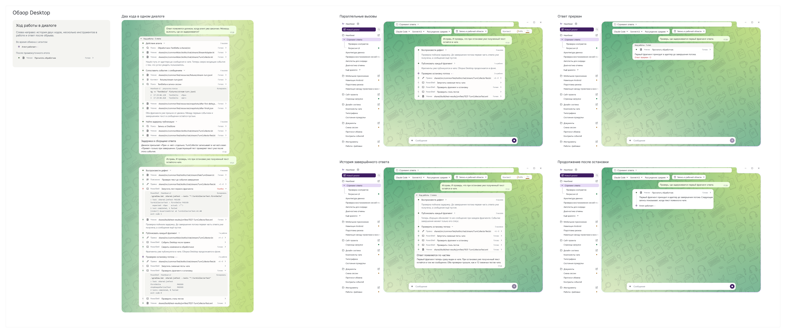
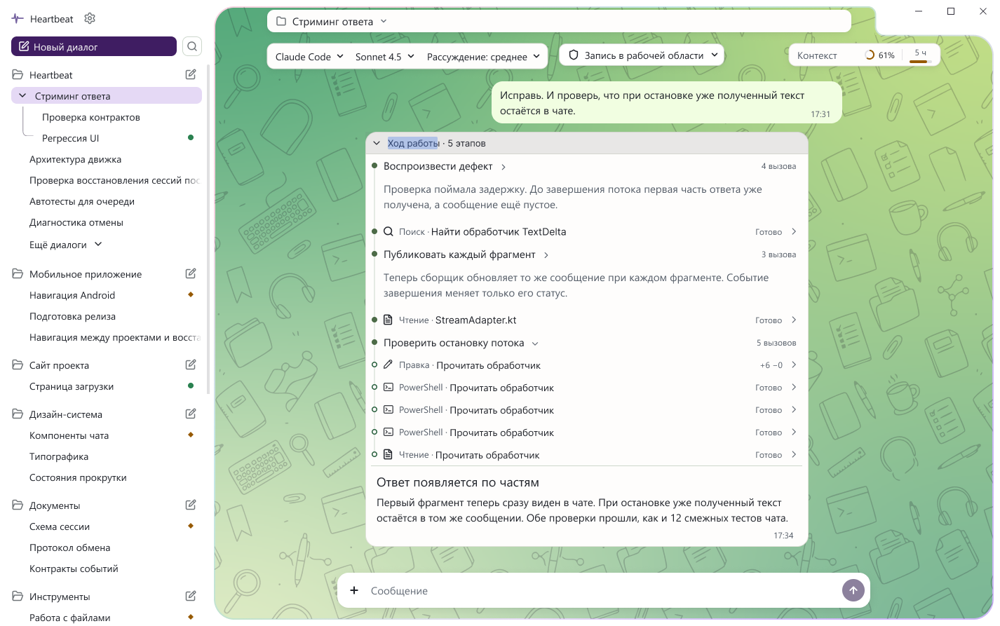

# Desktop Aurora · рабочая область агента

Одна отправка пользователя открывает один ответ агента. В одном облачке пользователь видит, чем агент занят сейчас, какие инструменты уже сработали и к какому выводу он пришёл. Первый фрагмент ответа появляется сразу. Последующие фрагменты дописываются туда же. [Рабочая область в Figma](https://www.figma.com/design/ivLmgulIBIkMzOw8sgvKxj/Aurora-DS?node-id=496-128870)

## От отправки до первого события

Слева остаётся навигация по проектам и диалогам. Над перепиской расположены название диалога, параметры агента, доступ к рабочей области и контекст. Поле ввода закреплено снизу. В многострочном черновике вложения видны над текстом. Пользователь может удалить отдельный файл. После отправки текст и оставшиеся вложения переходят в одну пользовательскую реплику.

После подтверждения доставки в переписке сразу появляются реплика пользователя и область ответа. На оси видны полое фиолетовое кольцо, подпись «Агент работает» и три точки. В поле ввода доступна остановка. Пока агент не прислал событий, у ответа нет истории вызовов и времени завершения. [Ожидание первого события](https://www.figma.com/design/ivLmgulIBIkMzOw8sgvKxj/Aurora-DS?node-id=467-159620) · [Черновики с вложениями](https://www.figma.com/design/ivLmgulIBIkMzOw8sgvKxj/Aurora-DS?node-id=477-177480)

## Текущий этап

На месте подписи ожидания появляется публичная цель агента, например «Проверяю остановку потока». Кольцо пульсирует во время обмена с LLM, три точки анимируются сразу после подписи. При уменьшенном движении кольцо и точки статичны. Диктор сообщает о начале ожидания один раз. Текущий этап всегда открыт. Его заголовок не имеет шеврона, а строка «Ход работы» появляется после окончания ответа.

Если агент не передал название, клиент один раз выбирает локальную подпись по типу событий. Для чтения подходит «Просмотр файлов», для команд — «Работа в терминале», для смешанного набора — «Работа по запросу». Если есть выбор, предыдущая подпись исключается. Выбор хранится по ID этапа. Поздняя цель агента заменяет подпись на месте. [Активные состояния](https://www.figma.com/design/ivLmgulIBIkMzOw8sgvKxj/Aurora-DS?node-id=467-163726) · [Наборы названий](https://www.figma.com/design/ivLmgulIBIkMzOw8sgvKxj/Aurora-DS?node-id=477-179898)

## Хронология и инструменты

У ответа одна вертикальная линия толщиной 1 dp. Она соединяет центры первого и последнего видимых маркеров. Строки этапов и инструментов стоят на общей оси. У пользовательской реплики с временем в строке вертикальные поля составляют 8 dp. У финального ответа со свёрнутой историей верхнее поле карточки также 8 dp. [Геометрия и компоненты](../design-system.md#ход-работы-инструменты-и-thinking)

| Событие | Изменение в карточке |
| --- | --- |
| Первый вызов | На линии появляется сам инструмент. Его строка открывает подробности. |
| Второй вызов того же этапа | Вызовы объединяются в группу. Первый сохраняет ID, положение, фокус и уже открытый результат. Параллельные вызовы перечисляются в порядке запуска. |
| Завершился один инструмент | Обновляется его строка. При успехе видны зелёное кольцо и «Готово», при ошибке — красное кольцо и «Ошибка». У успешной правки с известным diff допустимы счётчики добавленных и удалённых строк. Этап остаётся активным до публичного итога. |
| Инструмент ещё работает | У вызова серый индикатор с доступным именем «Выполняется». Частичный вывод дописывается в раскрытый результат. |
| В завершённом этапе был ровно один вызов | Строка инструмента сама представляет этап. На оси одна закрашенная точка. Шеврон у строки открывает результат. Единственная публичная запись «Размышления» оформляется так же, её название видно один раз. |

Содержимое раскрытия зависит от операции. Чтение показывает путь, язык, номера строк и фрагмент файла. Поиск показывает запрос и совпадения либо «Совпадений нет». Запись и правка показывают строки патча со знаками добавления и удаления. Команда показывает рабочий каталог, командную строку, stdout, stderr и код завершения. Для снимка контекста видны источник и содержимое. «Размышления» показывают только текст, который источник предоставил для пользователя. Длинная строка прокручивается внутри результата. Копирование и выделение вывода сохраняют раскрытие. [Лист раскрытых инструментов](https://www.figma.com/design/ivLmgulIBIkMzOw8sgvKxj/Aurora-DS?node-id=478-102742)

## Промежуточный итог

Публичный промежуточный итог завершает текущий этап в момент получения. В том же обновлении группа сворачивается, а у одиночного вызова закрываются подробности. Итог остаётся под строкой этапа. Если в группе ещё идут фоновые вызовы, справа видно их количество. Поздний результат обновляет исходный вызов по ID. Пользователь может повторно открыть подробности.

Если следующий шаг агента сразу приносит итог без инструмента, клиент добавляет его отдельным абзацем под предыдущим итогом. Несколько таких событий подряд сохраняют порядок поступления, ID этапа, число вызовов и один маркер. Повторная доставка события с тем же ID сохраняет один экземпляр абзаца. Если предыдущего этапа ещё нет, текст появляется прямо в сообщении. Если работа продолжается, под итогами виден один фиолетовый маркер следующего этапа. [Один итог после чтения](https://www.figma.com/design/ivLmgulIBIkMzOw8sgvKxj/Aurora-DS?node-id=496-129669) · [Два итога после группы](https://www.figma.com/design/ivLmgulIBIkMzOw8sgvKxj/Aurora-DS?node-id=496-130599)

## Финальный ответ и доступ к истории

Получение первого фрагмента финального текста сохраняет текущее раскрытие. Подтверждение завершения один раз сворачивает всю историю. В покое виден финальный текст с временем. При достаточном месте время помещается на последней строке с зазором от 8 dp. В узком облачке оно переходит ниже. Прямой ответ без инструментов и промежуточных событий заканчивается обычной репликой с временем.

На Desktop наведение или клавиатурный фокус показывают шапку «Ход работы · N этапов» над ответом. Высота шапки — 32 dp. Появление шапки сохраняет положение текста, времени и соседних сообщений. В открытой истории шапка занимает место в потоке. Заголовок можно выделить и скопировать: фон наведения остаётся виден до окончания жеста, отпускание мыши после выделения сохраняет состояние истории. Переключатель доступен с клавиатуры через Enter или пробел. После сворачивания фокус из скрытого содержимого возвращается к его шапке. На Android доступ к истории виден постоянно. [Выделение заголовка в Figma](https://www.figma.com/design/ivLmgulIBIkMzOw8sgvKxj/Aurora-DS?node-id=493-119687)

## Ошибки, повтор и продолжение

На Desktop меню сообщения открывается по ПКМ или через бейдж с шевроном у нижнего угла облачка. У пользователя бейдж расположен слева, у агента справа. Действия зависят от роли и состояния сообщения. Подсказка при наведении на статус ошибки раскрывает причину.

| Состояние | Что доступно пользователю |
| --- | --- |
| Сообщение не доставлено | «Ошибка отправки» относится к исходящей реплике. Команда «Отправить повторно» в её меню повторяет доставку с тем же текстом и файлами. В переписке остаётся одна реплика. |
| Ошибка вызова инструмента | Можно раскрыть и скопировать вывод. Повтор инициирует агент. Новая попытка получает собственный ID, исходная ошибка остаётся в истории. |
| Потеря соединения или обрыв ответа | Уже полученный текст и история остаются на месте. После восстановления связи доступное «Продолжить» в меню ответа дописывает текст в прежнее сообщение. |
| HTTP 429 | Если сервер указал срок ожидания, интерфейс показывает ограничение до его истечения. По окончании ожидания пользователь может продолжить из меню ответа. |
| Пользователь нажал Stop | Видно «Останавливаем…». После подтверждения появляется «Ответ остановлен». «Продолжить» сохраняет историю и уже полученный префикс. |

## Приёмка

1. Раскрыть первый поиск и дождаться второго вызова. Проверить, что прежний вывод остаётся открытым и у первого вызова сохраняется фокус.
2. Доставить итог при двух работающих командах. Проверить сворачивание в том же обновлении, затем доставить ещё два итога без вызовов. Под прежним этапом должны быть три абзаца. Поздний результат команды меняет только её исходную строку и счётчик.
3. Выделить мышью «Ход работы» в раскрытой истории, отпустить кнопку и скопировать выделение. Затем переключить историю с клавиатуры. Проверить фон наведения, положение ответа и возврат фокуса.
4. Повторить отправку сообщения с вложениями, затем прервать поток после первого фрагмента. Проверить одну пользовательскую реплику, сохранение текста ответа и продолжение в том же облачке. Для HTTP 429 отдельно пройти ожидание указанного сервером срока.
5. Включить уменьшенное движение. Проверить статичные кольцо и точки, доступное имя выполняющегося вызова и отсутствие повторных объявлений ожидания.

Снимки иллюстрируют согласованный прототип. Сетевые события, системное выделение текста, объявления диктора и восстановление диалога после перезапуска проверяются в приложении. [План и сценарии](../plans/aurora-chat-longread.md) · [Результаты проверки прототипа](../CHECKPOINT.md#проверка-прототипа)
