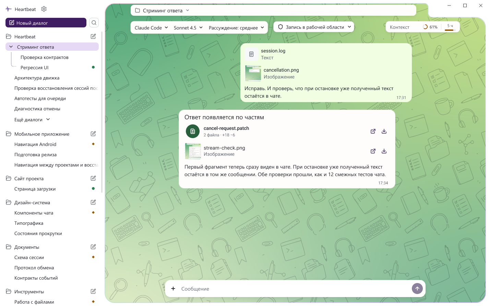
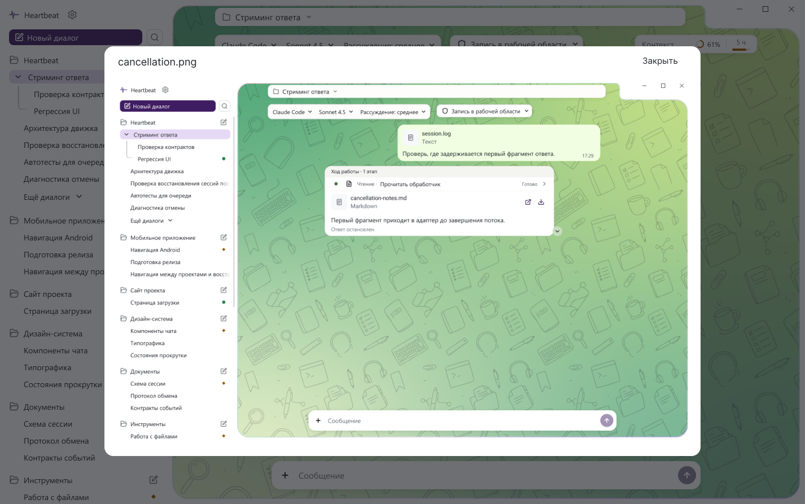
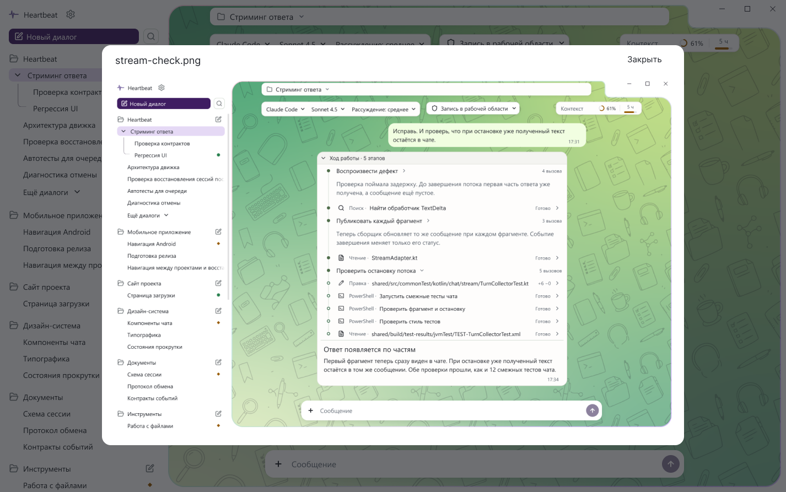

# Desktop Aurora · файлы и изображения в сообщениях

Пользователь отправляет журнал и снимок экрана. Агент возвращает патч и изображение с результатом проверки. Каждый файл находится в облачке своего автора рядом с текстом сообщения. У документа видны значок, имя с расширением и метаданные. У изображения на месте значка показана миниатюра самого файла. [Диалог в Figma](https://www.figma.com/design/ivLmgulIBIkMzOw8sgvKxj/Aurora-DS?node-id=502-142949)

## Строка вложения

В черновике каждый файл можно убрать отдельно. После отправки вложения остаются над подписью в исходном порядке. У нескольких файлов общий список внутри облачка. Между строками 4 dp, между списком и подписью 8 dp. Длинное имя переносится, полное имя и расширение доступны при чтении строки.

Слева от имени зарезервирована область 48 × 48 dp. При наличии превью изображение заполняет эту область с сохранением пропорций и скруглением 4 dp. Для документа используется значок типа файла. Справа от файла агента доступны действия просмотра и скачивания. У патча в метаданных можно показать число изменённых файлов и размер diff. Просмотр патча открывает изменения для чтения. [Геометрия и состояния вложений](../plans/aurora-attachments.md)

## Просмотр изображения

Нажатие на строку изображения открывает выбранное вложение поверх диалога. У изображения агента тот же просмотр доступен через кнопку открытия. В заголовке видно имя файла. Изображение целиком вписывается в окно с сохранением пропорций. «Закрыть» и щелчок по затемнённому фону возвращают к исходному сообщению.

| Изображение пользователя | Изображение агента |
| --- | --- |
|  |  |
| [Посмотреть кадр](https://www.figma.com/design/ivLmgulIBIkMzOw8sgvKxj/Aurora-DS?node-id=502-144061) | [Посмотреть кадр](https://www.figma.com/design/ivLmgulIBIkMzOw8sgvKxj/Aurora-DS?node-id=502-145023) |

## Состояние файла и сообщения

- Во время загрузки строка сохраняет имя файла и показывает фактический прогресс. При неизвестном объёме достаточно индикатора загрузки. Ошибка получения относится к конкретному вложению, повтор доступен рядом с ним.
- При ошибке доставки сообщения повторная отправка использует прежний набор вложений. При остановке потока или HTTP 429 файлы, уже полученные от агента, остаются в его ответе. Продолжение сохраняет их по ID.
- Открытие меню сообщения сохраняет состав и расположение файлов. Бейдж управляет репликой целиком, кнопки в строке артефакта — выбранным файлом. [Меню сообщения](desktop-aurora-message-actions.md) · [Семь сценариев с вложениями](desktop-aurora-agent-workspace.md#файлы-пользователя-и-агента)

Для приёмки открыть по очереди обе миниатюры в одном диалоге. Сверить имя и содержимое с выбранной строкой, закрыть просмотр и проверить положение переписки. Отдельно проверить документ, патч и скачивание оригинального файла в приложении.
