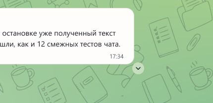
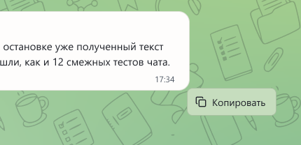
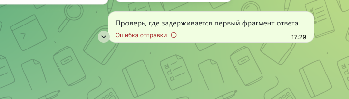
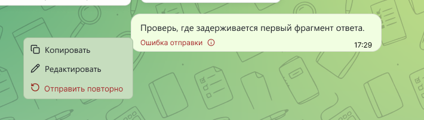

# Desktop Aurora · бейдж действий сообщения

При наведении на сообщение у его нижнего угла появляется круглый бейдж с шевроном. При нажатии **сама поверхность бейджа расширяется в меню**. В открытом состоянии на этом месте видны пункты действий, шеврон исчезает. ПКМ по сообщению открывает то же меню для выбранной реплики.

## Ответ агента

В завершённом текстовом ответе от верхнего края облачка до блока текста — 8 dp, от последней строки до нижнего края — 6 dp. Время помещается справа на последней строке. [Снимок ответа](../previews/desktop-agent-turns/completed-reply.png) · [Кадр в Figma](https://www.figma.com/design/ivLmgulIBIkMzOw8sgvKxj/Aurora-DS?node-id=477-178533)

Бейдж расположен у правого нижнего угла. При раскрытии левый край поверхности остаётся у сообщения, меню растёт вправо и вниз. У завершённого ответа доступно «Копировать». [До раскрытия](https://www.figma.com/design/ivLmgulIBIkMzOw8sgvKxj/Aurora-DS?node-id=493-125169) · [После раскрытия](https://www.figma.com/design/ivLmgulIBIkMzOw8sgvKxj/Aurora-DS?node-id=493-117220)

| Наведение | Нажатие на бейдж |
| --- | --- |
|  |  |

## Сообщение пользователя

В облачке с ошибкой доставки верхний внутренний отступ до первой строки — 8 dp. Это значение сохраняется при наведении, показе подсказки и раскрытии меню. Если первым идёт вложение, отступ измеряется до строки файла.

Между последней строкой сообщения и футером — 4 dp, от нижнего края футера до края облачка — 6 dp. Статус «Ошибка отправки» расположен слева, значок подсказки — в 4 dp от подписи, время — справа на одной линии со статусом. В сообщении с вложением отступы футера такие же.

Бейдж расположен у левого нижнего угла. Правый край открывающейся поверхности остаётся у сообщения, меню растёт влево и вниз. У недоставленной реплики видны «Копировать», «Редактировать» и «Отправить повторно». Причина ошибки доступна отдельно при наведении на статус. [До раскрытия](https://www.figma.com/design/ivLmgulIBIkMzOw8sgvKxj/Aurora-DS?node-id=493-123439) · [После раскрытия](https://www.figma.com/design/ivLmgulIBIkMzOw8sgvKxj/Aurora-DS?node-id=478-105095)

| Наведение | Нажатие на бейдж |
| --- | --- |
|  |  |

## Переход и действия

В прототипе видимый круг имеет диаметр 24 dp внутри области нажатия 32 × 32 dp. При раскрытии скругление поверхности меняется с 12 до 8 dp. Переход Smart Animate длится 160 мс с замедлением к концу. Строка действия занимает 32 dp по высоте, внешние поля меню — 4 dp. Размер меню определяется составом действий. Клик вне поверхности закрывает меню. Если указатель остаётся у сообщения, снова виден свёрнутый бейдж.

| Состояние сообщения | Доступные действия |
| --- | --- |
| Отправленная реплика пользователя | Копировать, редактировать |
| Ошибка доставки | Копировать, редактировать, отправить повторно с исходными текстом и вложениями |
| Завершённый ответ агента | Копировать |
| Ответ прерван или остановка подтверждена, продолжение доступно | Копировать, продолжить в том же ответе |
| Сеть недоступна, остановка ожидает подтверждения или ещё действует срок HTTP 429 | Копировать. «Продолжить» появляется, когда продолжение доступно |

Меню открывается поверх переписки. Текст, время, раскрытые инструменты и прикреплённые файлы сохраняют положение. Просмотр и скачивание файла остаются действиями его строки. [Меню остановленного ответа с вложением](https://www.figma.com/design/ivLmgulIBIkMzOw8sgvKxj/Aurora-DS?node-id=502-140701) · [Меню при HTTP 429 с вложением](https://www.figma.com/design/ivLmgulIBIkMzOw8sgvKxj/Aurora-DS?node-id=502-141828)

## Приёмка на Desktop

1. Открыть меню завершённого ответа кликом по бейджу. Сверить положение времени и края облачка до и после. В открытом состоянии у края одна поверхность с действием «Копировать».
2. Открыть меню недоставленной реплики по ПКМ. Убедиться, что пункты относятся к выбранной реплике. Закрыть кликом снаружи и повторить через шеврон.
3. Остановить ответ с уже полученным файлом. После подтверждения открыть меню, выбрать «Продолжить» и проверить, что текст и файл остались в том же сообщении.
4. Открыть меню во время ожидания после HTTP 429 и после истечения срока. Сверить доступность продолжения и сохранность вложения. [Контракт рабочей области](desktop-aurora-agent-workspace.md)
