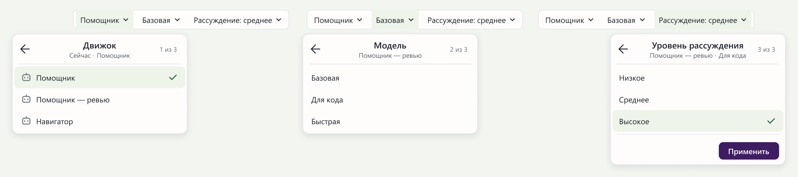
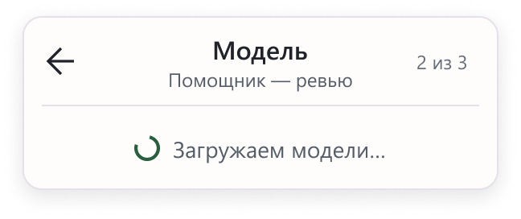

# Aurora · Смена движка в чате

В шапке чата пользователь выбирает движок, одну из его моделей и доступный для этой модели уровень рассуждения. Выбор уровня сразу применяет все три значения. Если уровни отсутствуют или не загрузились, кнопка «Применить» сохраняет движок и модель без явно заданного уровня. До этого шапка показывает действующие параметры чата.

## Открытие и выбор

При открытии меню действующие значения копируются в черновик. Кнопка движка открывает первый шаг. Кнопка модели открывает второй шаг для действующего движка. Кнопка рассуждения открывает третий для действующей пары движок–модель.

| Шаг и подзаголовок | Выбор и переход |
| --- | --- |
| **1 из 3 · Движок**. Один заголовок по центру | Список содержит настроенные движки, галочка отмечает выбранный. Нажатие строки открывает шаг «Модель». При выборе другого движка сбрасываются черновые модель и уровень. [Кадр](https://www.figma.com/design/ivLmgulIBIkMzOw8sgvKxj/Aurora-DS?node-id=426-60903) |
| **2 из 3 · Модель**. Под заголовком имя выбранного движка | Приходят модели этого движка. Нажатие строки открывает шаг «Уровень рассуждения». При выборе другой модели сбрасывается черновой уровень. [Кадр](https://www.figma.com/design/ivLmgulIBIkMzOw8sgvKxj/Aurora-DS?node-id=426-60939) |
| **3 из 3 · Уровень рассуждения**. Под заголовком «Помощник — ревью · Для кода» | Список содержит уровни выбранной модели. Галочка отмечает текущий уровень. Выбор строки сразу применяет все три значения и при успехе закрывает меню. [До выбора](https://www.figma.com/design/ivLmgulIBIkMzOw8sgvKxj/Aurora-DS?node-id=426-60957) · [Текущий уровень](https://www.figma.com/design/ivLmgulIBIkMzOw8sgvKxj/Aurora-DS?node-id=426-60975) |

«Назад» возвращает на предыдущий шаг с его черновым выбором. Если снова выбрать тот же движок или ту же модель, сохраняются совместимые значения следующих шагов. Возврат с первого шага, нажатие вне меню и Escape закрывают визард. При следующем открытии он снова берёт значения из чата.

## Загрузка моделей

При переходе на второй шаг заголовок «Модель», имя движка и текст «Загружаем модели…» появляются сразу. Кольцо и подпись появляются вместе по центру области списка с просветом 8 dp. Первые **400 мс** кольцо статично. При более долгом ожидании начинается вращение вокруг его центра. В режиме уменьшенного движения индикатор статичен. При наличии актуального списка для этого движка модели видны сразу. [Загрузка на Desktop](https://www.figma.com/design/ivLmgulIBIkMzOw8sgvKxj/Aurora-DS?node-id=426-60921) · [Загрузка на Android](https://www.figma.com/design/ivLmgulIBIkMzOw8sgvKxj/Aurora-DS?node-id=426-61100)

Пока идёт запрос, доступны возврат и закрытие. Список и ошибки обновляет только последняя попытка загрузки для текущего движка в открытом меню. Если пользователь выбрал другой движок, повторил запрос или закрыл визард, запоздалый ответ предыдущей попытки отбрасывается.

| Состояние | Что видит и делает пользователь |
| --- | --- |
| Движок вернул пустой список | «У этого движка нет доступных моделей». «Выбрать другой движок» возвращает на первый шаг. [Кадр](https://www.figma.com/design/ivLmgulIBIkMzOw8sgvKxj/Aurora-DS?node-id=426-61029) |
| Список получить не удалось | «Не удалось загрузить модели». «Повторить» заново запрашивает модели того же движка. [Кадр](https://www.figma.com/design/ivLmgulIBIkMzOw8sgvKxj/Aurora-DS?node-id=426-61011) |
| Модель сообщает, что выбор уровня не поддерживается | На третьем шаге видны «Модель не поддерживает выбор уровня рассуждения» и активная кнопка «Применить». В чат передаётся выбранная пара с отсутствующим уровнем. При пустом списке действует тот же порядок. [Кадр](https://www.figma.com/design/ivLmgulIBIkMzOw8sgvKxj/Aurora-DS?node-id=426-61047) |
| Не загрузились уровни | Кнопка «Применить» сохраняет выбранные движок и модель без явного уровня. [Desktop](https://www.figma.com/design/ivLmgulIBIkMzOw8sgvKxj/Aurora-DS?node-id=556-157333) · [Android](https://www.figma.com/design/ivLmgulIBIkMzOw8sgvKxj/Aurora-DS?node-id=556-157699) |
| Чат отклонил применение | На третьем шаге остаются выбранные значения и сообщение «Не удалось применить настройки». «Повторить» отправляет ту же комбинацию. Шапка чата сохраняет последнюю подтверждённую конфигурацию. [Кадр](https://www.figma.com/design/ivLmgulIBIkMzOw8sgvKxj/Aurora-DS?node-id=426-61065) |

## Верхняя панель и управление

На всех шагах у самого меню верхняя панель высотой 56 dp при стандартном масштабе текста. На первом шаге по центру стоит заголовок «Движок». На следующих шагах под заголовком видны выбранные параметры. Ширина меню составляет 296 dp на Desktop и до 326 dp на Android. Фон выбора и наведения заполняет всю строку до внешнего контура меню. Стрелка возврата находится слева, счётчик шагов — справа. В шапке чата подсвечивается параметр открытого шага.

На **Windows и macOS** меню раскрывается вниз под соответствующей кнопкой. Например, центр заголовка «Модель» совпадает с центром значения «Базовая», в том числе во время загрузки и при ошибке. На третьем шаге меню привязано к значению рассуждения. У края окна меню сдвигается внутрь доступной области. Стрелки клавиатуры перемещают фокус по списку, Enter выбирает строку, после закрытия фокус возвращается на кнопку, из которой открыли визард.

На **Android** группа параметров в шапке прокручивается до активной кнопки. Меню помещается в доступную ширину, заголовок с подзаголовком сохраняют центральное выравнивание. Строки, возврат и «Применить» имеют сенсорную цель от 48 dp. Системное действие «Назад» повторяет действие стрелки в панели. [Третий шаг на Android](https://www.figma.com/design/ivLmgulIBIkMzOw8sgvKxj/Aurora-DS?node-id=426-61151)

## Критерии приёмки

1. Выбрать «Помощник — ревью» → «Для кода» → «Высокое». После выбора уровня меню закрывается. В шапке видны все три новых значения. [Результат](https://www.figma.com/design/ivLmgulIBIkMzOw8sgvKxj/Aurora-DS?node-id=556-158378)
2. С третьего шага вернуться к модели, выбрать ту же модель и проверить сохранённый уровень. Выбрать другую модель с поддержкой рассуждения и проверить, что уровень требуется выбрать заново. Закрыть меню и снова открыть его через каждую из трёх кнопок.
3. Проверить быстрый ответ и ответ дольше 400 мс. Во время загрузки вернуться и выбрать другой движок. Поздний ответ первого запроса не должен менять второй список или действующую конфигурацию.
4. Получить пустой список, ошибку загрузки и ошибку применения. Проверить соответствующие действия восстановления. Для модели без выбора уровня применить пару и убедиться, что уровень предыдущей модели сброшен.
5. На узком экране проверить границы меню и видимость активного параметра. На Desktop пройти выбор с клавиатуры и закрыть по Escape. На Android вернуться с третьего шага до чата системным действием «Назад».

Названия движков, моделей и уровней в кадрах — демонстрационные. Доступные варианты определяются выбранным движком и моделью. [План и полная карта кадров](../plans/aurora-engine-change-wizard.md)
