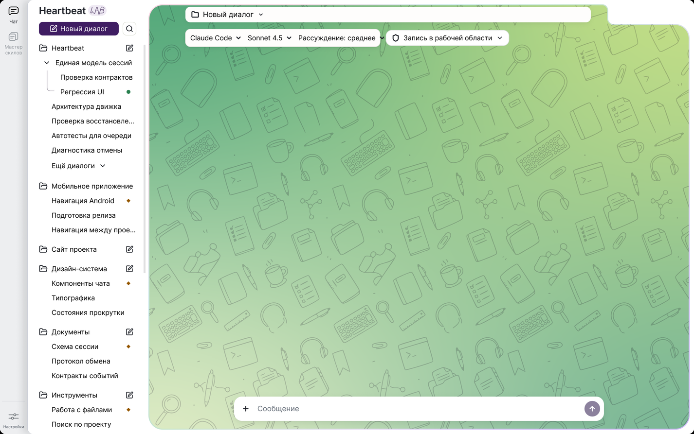
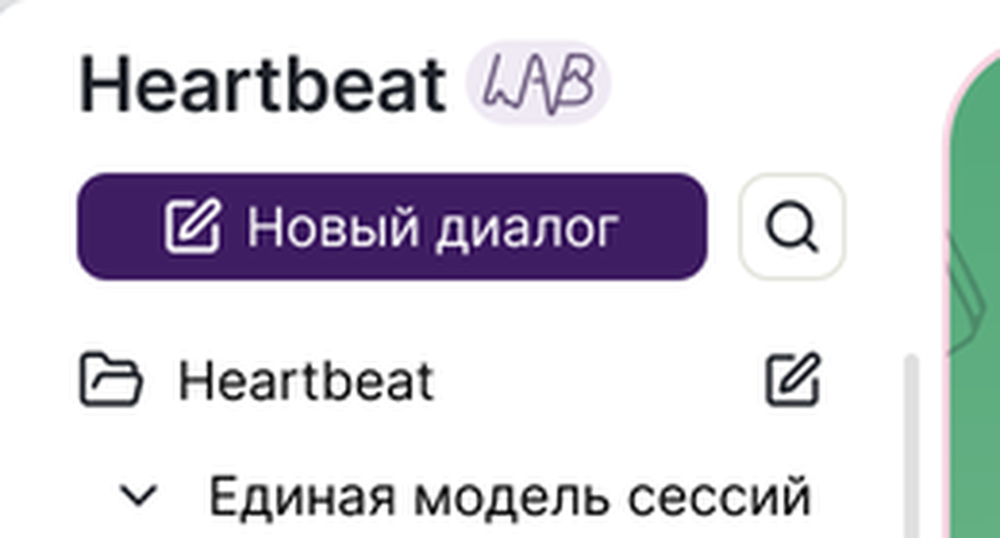
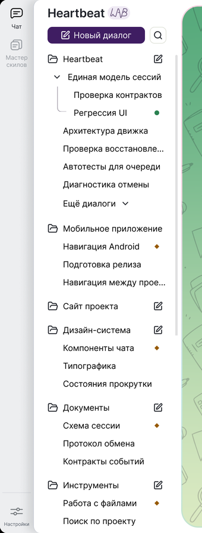
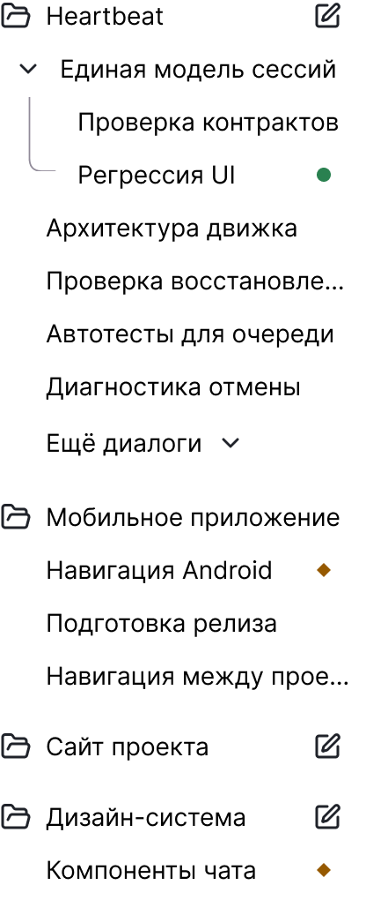
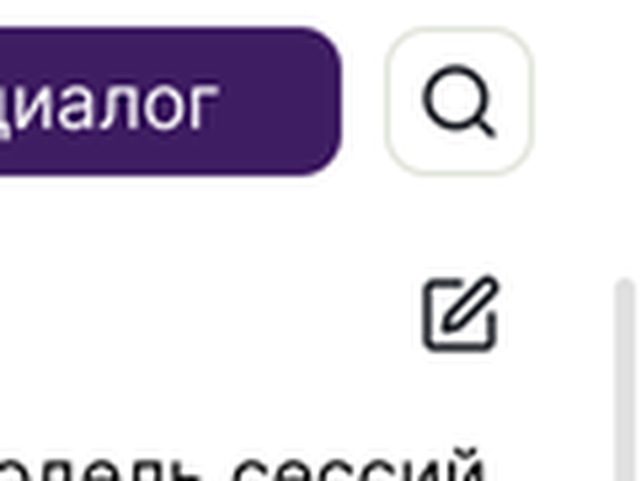

# Aurora · Heartbeat Lab: брендинг левой панели

Кадр «Чат» `579:152852` на странице [Heartbeat Lab](https://www.figma.com/design/ivLmgulIBIkMzOw8sgvKxj/Aurora-DS?node-id=579-152852) переходит от набора рабочих кадров к продуктовому экрану Heartbeat Lab: в шапке панели стоит название продукта целиком — Heartbeat LAB, рейл стал подписанным и прижат к рамке окна, список сессий — белой карточкой с тенью на рейл. Desktop 1426 × 893; Android наследует роли следующим проходом.

## Название продукта

Продукт называется **Heartbeat LAB**, и в шапке панели имя набрано целиком, одной строкой: слово «Heartbeat» — Segoe UI Semi Bold 20 / 23, трекинг −0,2, `#20232A`, сразу за ним знак LAB — пилюля 38 × 22 `#EFEAF4` с рукописной надписью `#6A5883`. Зазор между словом и знаком 4. Слева знака больше нет: имя начинается от левого края панели.

LAB — часть названия, а не метка сборки, версии или статуса. Поэтому знак стоит вплотную к слову, в одну строку и в одну краску с ним, без точки, разделителя и цветового акцента статуса: имя не разрывается на «продукт + бейдж». Слои так и названы — `Название · Heartbeat LAB`, `Heartbeat LAB · слово`, `Heartbeat LAB · знак LAB`.

Оболочка названия `HUG` по горизонтали: авто-лейаут, зазор 4, без внутренних полей — сейчас 139 × 23, справа пустоты нет.

Вертикальный ритм задан по рамкам: верх окна → название 10, название → строка действий 12, строка действий → список 12. Верхнее поле меньше остальных намеренно: его задаёт знак LAB высотой 22, который выше капители слова, поэтому по краске верхний отступ читается наравне с промежутками между блоками.

## Строка действий

Кнопка «Новый диалог» занимает всю ширину строки минус поиск: 164 × 28, радиус 8, `#3F1D62`, значок 16 и подпись 14 / 20 по центру. Поиск — 28 × 28, радиус 8, белая поверхность, контур 1 px `#DFE2D8`, иконка 16 по центру. Зазор между ними 8.

| Элемент | Геометрия | Положение |
| --- | --- | --- |
| Строка действий | 200 × 28 | 80 / 45 |
| «Новый диалог» | 164 × 28, радиус 8 | 80 / 45 |
| «Поиск по диалогам» | 28 × 28, радиус 8 | 252 / 45 |

Строка, шапка и строки списка живут в одних границах 80…280: левый и правый край кнопки, поиска и списка совпадают, поэтому композиция не «едет» при длинных названиях.

## Рейл рабочей области

Рейл прижат к рамке окна: 56 × 893 в 0 / 0, скругление 12 по левым верхнему и нижнему углам, заливка `#EDEEF0`. Внутренние отступы: 10 сверху и снизу, 4 по бокам. Пункт 48 × 40, иконка 24 по центру, подпись под ней на ширине 48.

| Пункт | Иконка и подпись | Состояние |
| --- | --- | --- |
| «Чат» | 24, подпись 10 / 12 | выбранный: `#000000` и `#20232A` |
| «Мастер скилов» | 24, подпись 10 / 12 в две строки | недоступный: `#969BA1` |
| «Настройки» | 24, подпись 8 / 10 | доступный: `#5F6368` и `#555D68` |

Выбранный пункт отмечается только цветом иконки и подписи — плитка, её заливка, контур и тень сняты. Перед подвалом стоит линия 48 × 1 `#D9DBE0`, сам подвал — в 12 от низа. Первая иконка стоит на оси названия: центр шапки 29, краска названия 21,8…37, слот иконки «Чата» 17…41, её краска 20,8…37,5.

Размер подписи выбирается 10 → 9 → 8, многоточие включается только если не помещается и 8. Сейчас 10 хватает «Чату» и «Мастеру скилов», «Настройкам» нужно 8.

## Список сессий как карточка

Список — белая карточка 232 × 893 в 56 / 0: заливка `#FFFFFF`, радиус 12 по левым верхнему и нижнему углам, справа прямой. С рейлом её разделяет контур 1 px `#C9CED6` только слева; он повторяет радиус, поэтому линия загибается на обоих углах. От карточки на рейл падает тень: `DROP_SHADOW` `#20232A` 13 %, смещение −10 / 0, размытие 16 — подложка у края темнеет с `#EDEEF0` до `#D7D9DB`.

Окно `579:152852` имеет радиус 12 и `clipsContent`: скругление окна и рейла совпадают, белого клина в углу нет. Поля кадра нулевые — чат вынесен в обёртку `580:153648` (1122 × 893 в 304 / 0, поля 8 / 8 / 8 / 0), чтобы сохранить белое поле под системными кнопками окна.

## Строки списка

Вьюпорт списка 200 × 800 в 80 / 85, содержимое 200 px. Строка проекта и сессии — 28 высотой, скругление 10 у поверхностей выделения. Длинные названия обрезаются многоточием по ширине слота: три подписи в кадре — «Проверка восстановле…», «Навигация между прое…», «Единая модель с…».

Ручка «Новая сессия» в строке проекта — 28 × 28, как и поиск: обе стоят в 252…280, краски иконок совпадают (259,2…272,5). Точка состояния сессии — 8 × 8 по правому краю строки.

## Известные ограничения

- В кадре лежит вторая, скрытая копия списка `579:152865`. Она не отображается, но хранит те же сессии и путает правки; её стоит удалить отдельным проходом.
- Многоточие стоит в самих символах названия: плагин не записывает `maxLines`, поэтому авто-`textTruncation` в Figma не применяется. В реализации это `TextOverflow.Ellipsis` с ограничением одной строки.
- Плавное затухание названия у правого края (`Название сессии / плавное затенение`) в кадре не реализовано: текст режется по границе слота.

## Критерии приёмки

1. Название: «Heartbeat» 20 / 23 Semi Bold и знак LAB 38 × 22 в одной строке через 4 — надпись читается как одно имя Heartbeat LAB, оболочка по содержимому (139 × 23) без пустоты справа. Верх окна → название 10, название → строка действий 12, строка → список 12.
2. Строка действий: кнопка 164 × 28 и поиск 28 × 28 стоят в границах 80…280, зазор 8, высота обоих 28, радиус 8.
3. Рейл: 56 px вплотную к левому, верхнему и нижнему краю окна; пункты 48 × 40 с отступами 10 сверху и снизу и 4 по бокам; выбранный пункт отличается только цветом иконки и подписи; подписи 10 / 12, «Настройки» 8 / 10, многоточие только после 8.
4. Список: белая карточка с радиусом 12 слева, контур `#C9CED6` по дуге, тень на рейл; строки 200 px, длинные названия с многоточием, ручки 28 × 28 в одной колонке с поиском.
5. Оси: центр названия 21,5, краска иконки «Чата» 13,5…30,5 (центр 22); поиск и «Новая сессия» 252…280.
